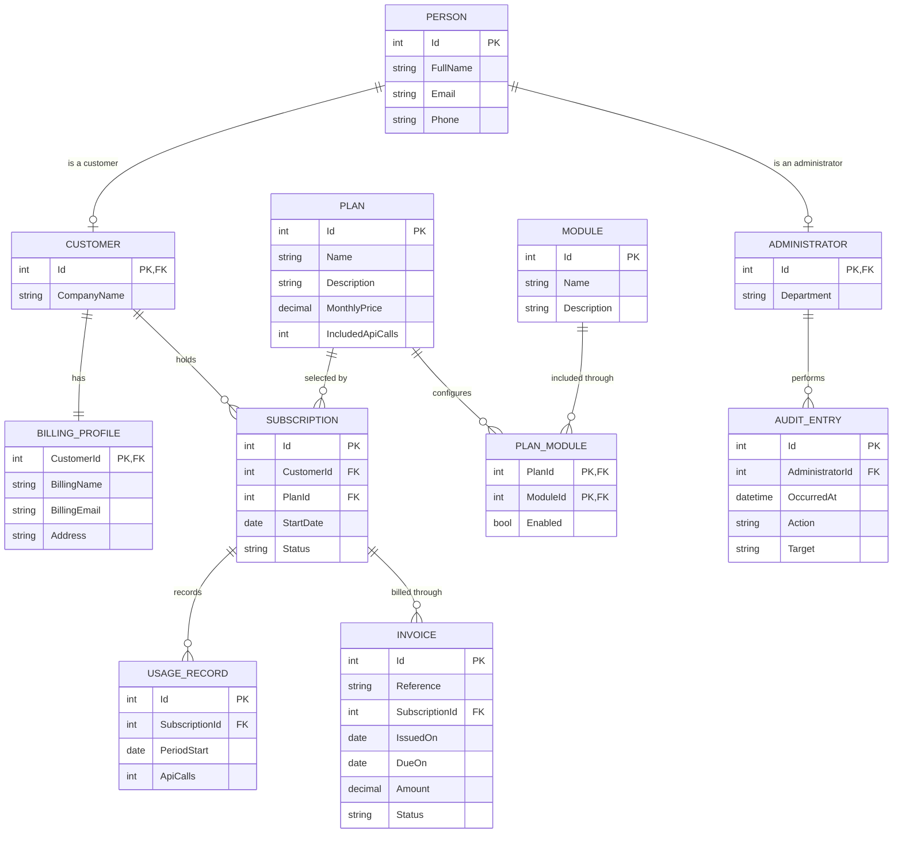

# QuTech Lab 2 design notes

Student: Justin Lee. Project: JustinLee-Lab2.

## Background and scope

QuTech is expanding a SaaS platform that offers flexible subscription plans and reusable modules. Administrators need to understand who uses the service, which capabilities each plan includes, how much customers consume, what they owe and who performed important operations. Lab 2 establishes the proposed data model and the MVC interface. The implementation uses fictional data and validates previews; it does not claim to implement the Lab 3 operational platform.

### Use cases

| Actor / need | Prototype interaction | Planned operational outcome |
| --- | --- | --- |
| Operations administrator: review service health | Open Overview and Analytics; follow subscription links | Identify customer adoption, recurring revenue and usage |
| Customer support: maintain contact details | List customers, inspect subscriptions, preview a new customer | Maintain an accurate customer directory |
| Billing administrator: maintain invoice contacts | Open a customer's billing profile and preview changes | Send invoices to the right organisation and address |
| Product administrator: define offerings | Inspect plans and modules; preview their configuration | Offer capabilities through several subscription tiers |
| Operations administrator: assign a plan | Preview a subscription with an existing customer and plan | Start or change a customer's service agreement |
| Operations administrator: review consumption | List usage records and inspect monthly allowances | Identify customers approaching their plan allowance |
| Billing administrator: review charges | List invoices and preview an invoice with valid dates/amount | Track payment status and outstanding amounts |
| Service manager: establish accountability | Inspect read-only audit history and administrators | Trace service changes to the responsible person |

Roles above are requirements-analysis actors, not implemented security roles. There is no login system in this prototype.

## Proposed ERD

`Person` is an abstract superclass; its inherited fields appear in both concrete person types. The ERD below shows business entities. In a future relational implementation, Person IDs would be globally unique and subtype rows would use the same ID as their parent. No inheritance database mapping is selected in Lab 2.

Inheritance is explicitly represented in C# as `Customer : Person` and `Administrator : Person`. The Person links in this ERD describe subtype identity, not two additional application relationships. A persisted Person must have a corresponding subtype under this design. In the prototype, customer IDs 1–3 and administrator IDs 101–102 are disjoint.

### Cardinalities and justification

- **One-to-one:** Customer–BillingProfile. Each established customer has exactly one invoice destination. CustomerId is both the proposed profile primary key and foreign key. New-customer previews are incomplete drafts, not established stored customers.
- **One-to-many:** A Customer can hold multiple Subscriptions over time. A Plan may serve many Subscriptions. Each Subscription has one Customer and one Plan.
- **Many-to-many:** Plan–Module uses PlanModule. A capability such as Workspace appears in several plans, and a plan contains several capabilities. The pair `(PlanId, ModuleId)` is unique in the proposed schema; Enabled describes the assignment. The configuration preview can represent a new link or change to an existing pair.
- **One-to-many:** A Subscription has UsageRecords for reporting periods and Invoices for billing. A future database should make `(SubscriptionId, PeriodStart)` unique when each row represents a complete monthly total.
- **One-to-many:** An Administrator is associated with many AuditEntries. An audit entry records an action and a target reference. Target is a descriptive snapshot, not a polymorphic foreign key. This retains historical meaning even if records later change.
- **Inheritance:** Shared contact fields belong in Person. Customer adds CompanyName; Administrator adds Department. This avoids duplicating the same contact definitions in two classes.

## Model dictionary

All domain classes are in `JustinLee-Lab2/Models`. Nullable numeric and date input properties allow missing values to produce friendly validation errors rather than silently becoming zero or the earliest date. They are mandatory for a valid persisted record in the proposed design. Navigation properties are not user inputs.

| Class | Properties and purpose | Validation / design rules |
| --- | --- | --- |
| Person (abstract) | Id: identity; FullName: human contact; Email and Phone: communication channels | Required name/email/phone; name ≤80; EmailAddress and Phone attributes with custom messages |
| Customer | Inherited person fields; CompanyName: organisation; BillingProfile: invoice destination; Subscriptions: service history | Required company name ≤100; shared person validation |
| Administrator | Inherited person fields; Department: operational responsibility; AuditEntries: recorded activity | Required department ≤60; shared person validation |
| BillingProfile | CustomerId: shared identity/owner; BillingName: billed organisation; BillingEmail: invoice destination; Address: invoice address; Customer: owner | Existing customer route ID; billing name ≤100, address ≤200, required fields and valid email |
| Plan | Id; Name: tier label; Description: intended audience; MonthlyPrice: recurring AUD price; IncludedApiCalls: monthly entitlement; PlanModules and Subscriptions: relationships | Required name ≤60, description ≤250; required price ≥0 and allowance ≥1 |
| Module | Id; Name: capability label; Description: business purpose; PlanModules: plan assignments | Required name ≤60 and description ≤250 |
| PlanModule | PlanId and ModuleId: composite identity; Enabled: availability in this plan; Plan and Module: related objects | Required IDs must identify existing sample entities; boolean must bind successfully |
| Subscription | Id; CustomerId and PlanId: contract parties; StartDate: commencement; Status: lifecycle; Customer and Plan navigation; UsageRecords and Invoices collections | Required existing customer/plan and valid start date; status Active, Trial or Paused |
| UsageRecord | Id; SubscriptionId: measured service; PeriodStart: reporting period; ApiCalls: usage volume; Subscription navigation | Required existing subscription, valid date and whole-number usage ≥0 |
| Invoice | Id; Reference: human-readable invoice code; SubscriptionId: billed service; IssuedOn and DueOn: payment timing; Amount: AUD billed; Status: payment state; Subscription navigation | Required reference ≤30, subscription, dates and amount ≥0; due date ≥issue date; status Draft, Unpaid or Paid |
| AuditEntry | Id; AdministratorId: responsible person; OccurredAt: time; Action: operation snapshot; Target: affected record reference; Administrator navigation | Required administrator/time/action/target; action ≤200 and target ≤80; read-only sample history |

Identifiers are assigned internally in the demonstration dataset and are not editable form fields. Business strings use custom DataAnnotations messages. Invalid number/date values receive custom field messages in Razor using `GetValidationState`. Explicit controller checks use `AddModelError` and `IsValid`. A future persistence layer must additionally enforce key uniqueness, required foreign keys and the cardinalities described above.

### Supporting classes

- **DemoData:** Creates new in-memory lists for each controller request and links their navigation properties using object initialisers, collections and lambdas. It is a demonstration data container, not a database table or persistent repository.
- **DashboardViewModel:** Holds customer count, active subscription count, monthly recurring revenue, unpaid amount, total API calls and selected related records. HomeController calculates these values; Razor presents them. It is not a database entity and requires no user-input annotations.

## Controller and action inventory

Conventional route: `{controller=Home}/{action=Index}/{id?}`. GET is used for views and POST for form preview validation. Unknown detail IDs return 404.

| Controller | Actions | Responsibility and views |
| --- | --- | --- |
| HomeController | Index GET; Analytics GET; About GET | Overview of customers, active plan revenue and unpaid invoices; usage/allowance comparison; project scope |
| CustomersController | Index GET; Details GET(id); Create GET/POST | Customer directory, linked billing profile and subscriptions, validated contact preview |
| BillingProfilesController | Edit GET/POST(id) | Existing customer's billing details and validated edit preview; ID comes from route |
| AdministratorsController | Index GET; Details GET(id); Create GET/POST | Operational contacts, their audit history, validated new-contact preview |
| PlansController | Index GET; Details GET(id); Create GET/POST | Tier comparison, included modules, validated plan-price/allowance preview |
| ModulesController | Index GET; Details GET(id); Create GET/POST | Software capabilities and their linked plans, validated capability preview |
| ConfigurationController | Index GET; Create GET/POST | Plan/module assignments; preview enabled/disabled settings |
| SubscriptionsController | Index GET; Details GET(id); Create GET/POST | Customer/plan contracts, related usage and invoices, validated assignment preview |
| UsageController | Index GET; Details GET(id); Create GET/POST | Monthly API records and validated usage preview |
| InvoicesController | Index GET; Details GET(id); Create GET/POST | Billing list and details, validated invoice preview |
| AuditController | Index GET | Read-only sample audit history, linked to administrators |

A successful Create POST returns the controller's Details view with the submitted data and an explicit preview notice. Configuration and BillingProfiles return their form with the notice. Neither path modifies DemoData. There are no fake save, delete or payment buttons.

## View design

The shared layout provides QuTech branding, a workspace navigation menu, a persistent demonstration notice, page title and footer. Large screens use a sidebar; narrow screens use a horizontally scrollable navigation bar. Each page has one primary heading. Forms pair labels with controls and show both a general correction notice and specific custom messages. Tables provide readable business data and links to related detail pages. Plans have descriptions, price, allowance and included modules. Currency labels specify AUD.

Home presents four metrics and a subscription table. Revenue is the sum of active plan prices (149 + 399 = 548 AUD/month); trial subscriptions are excluded. Unpaid invoices total 399 AUD. The analytics page shows September usage (32,400 + 142,600 + 7,200 = 182,200 calls) against each plan allowance. No tax, proration, predictive analysis or background billing process is implied.

The [screen inventory](SCREENS.md) maps the 28 page templates to screenshots. Shared `_Layout`, `_ViewImports` and `_ViewStart` support those pages and are not separate navigation destinations.

## Project sequence and remaining work

1. Analyse the QuTech brief and use cases; identify entities and their relationships.
2. Establish MVC folders, controller actions and shared layout.
3. Add fictional sample records, relationship links and business-specific Razor pages.
4. Add form binding, annotations and explicit validation; inspect outputs and broken links.
5. Assemble the final written assessment report from these notes, ERD and screenshots; check it against the actual rubric before submitting.
6. In Lab 3, choose and implement database mapping, constraints, authentication and permissions, persistent CRUD, billing workflows and automatic audit capture. Those choices require the later course material and are not introduced here.

## Sources

The six supplied NIT3112 lecture decks, the actual QuTech Lab Assessment 2 screenshots, and the two supplied sample PDFs. The sample APTA scenario and club-management ERD were not reused. See SOURCE-MAP.md for lecture locations. No external tutorial was used to design the application.
